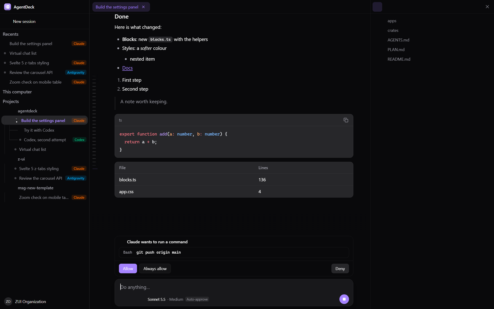

<div align="center">


# AgentDeck

**One desktop chat for all your AI coding agents.**
Drive Claude Code, Codex, Antigravity, OpenCode and your own providers side by side, with a live preview browser, multi-agent flows, Office files, usage limits and an audit log.

[](https://github.com/vuboi/agentdeck/releases/latest)
[](https://github.com/vuboi/agentdeck/releases)
[](https://github.com/vuboi/agentdeck/actions/workflows/release.yml)
[](https://github.com/vuboi/agentdeck/stargazers)
[](Cargo.toml)


[**Download**](https://github.com/vuboi/agentdeck/releases/latest) · [Install](#install) · [Features](#features) · [Develop](#develop)

<br />



</div>

---

## Features

### Agents and conversations

- **Many agents, one chat.** Claude Code, Codex, Antigravity, OpenCode and custom providers in the same window. Switch agent or model in the middle of a chat: each reply keeps the agent that wrote it, and the new one gets the turns it missed.
- **Your history, imported.** Existing Claude Code and Codex chats show up by project, ready to continue.
- **Live steps.** Commands fold into one counting line ("Ran 5 commands") with an icon per kind of step (edit, run, search, MCP tool, skill), thinking sits inside it, file edits show coloured diffs, and the agent's plan appears as a checklist card.
- **Replies read as one.** Consecutive replies of the same agent share one name line and one footer, with a thin line between them and the usage of the whole run in one tooltip.
- **Run in terminal.** Shell code blocks in the chat have a **Run** button that runs the command in the built-in terminal.
- **Read aloud.** A speaker button under each answer. Vietnamese is read by an offline voice ([Piper](https://github.com/rhasspy/piper), downloaded the first time); English by your system voice.

### Files and media

- **File paths are links.** A path in an answer (Windows, macOS or Linux, even a raw one) becomes a link showing the file name. Existing files are bold, missing ones faded; folders open in the file manager; right-click to open, reveal, copy the path or copy it as a `file://` URL. Paths in code are left alone.
- **Pictures and videos.** Web pictures are fetched by the app and shown (redirects and local-network addresses are checked); local pictures and videos appear as small thumbnails that open in one gallery.
- **Office files.** [OfficeCLI](https://github.com/iOfficeAI/OfficeCLI) is installed on demand (Settings → Office files) and registered as an MCP server and skill, so agents can create, read and edit Word, Excel and PowerPoint files without Office installed.

### Orchestration

- **Multi-agent flows.** Build flows on a canvas: one agent writes, another reviews, the owner fixes what blocks. Flow templates and per-flow history included.
- **Delegated workers.** An agent can hand work to others: up to 4 run at once, the rest wait in line. Each worker shows its state and waiting messages, and a failed one has a retry button.
- **Project memory.** A short shared note per project (`.agentdeck/memory.md`) that every agent reads when a conversation starts and adds to as it learns. Edit it in Settings → Memory.
- **Reply conventions.** Every new conversation is told to return files as links named after the file and to keep web pictures local. Editable in Settings → Replies.
- **Clean shutdown.** Agent CLIs, terminals, MCP servers and dev servers end with the app, even when the app is killed or crashes; leftovers from an earlier run are ended at the next start.

### Tools

- **Embedded preview browser.** The agent can see and operate your page (click, type, screenshot, console, network), and you can mark up the live page. Developer tools (Network, Application, Console) are docked at the bottom.
- **MCP, skills and plugins in one place.** Manage MCP servers and skills for every agent from one list, with a Store to discover more.
- **Usage limits.** Claude and Codex limit status, token and cost counters (with a monthly estimate), and a warning when you are near a limit.
- **Audit log.** Every tool call and error is kept on disk, grouped by day, with the screenshots tools returned.
- **Built-in updates.** The app tells you when a new version is out and installs it for you.

## Install

Pick your system on the [**latest release**](https://github.com/vuboi/agentdeck/releases/latest) page.

| System | Download | Notes |
| --- | --- | --- |
| **Windows** 10/11 | `AgentDeck_x64-setup.exe` (or `.msi`) | Run the installer. If SmartScreen warns, choose *More info → Run anyway*. |
| **macOS** Apple silicon | `AgentDeck_aarch64.dmg` | Open the `.dmg`, drag AgentDeck to *Applications*. |
| **macOS** Intel | `AgentDeck_x64.dmg` | Same as above. |
| **Linux** | `AgentDeck_amd64.AppImage`, `.deb` or `.rpm` | See below. |

<details>
<summary><b>macOS: "AgentDeck is damaged" or "cannot be opened"</b></summary>

The app is not notarized yet. Right-click AgentDeck in *Applications* and choose **Open** once, or run:

```bash
xattr -dr com.apple.quarantine /Applications/AgentDeck.app
```

</details>

<details>
<summary><b>Linux</b></summary>

```bash
# AppImage
chmod +x AgentDeck_*.AppImage && ./AgentDeck_*.AppImage

# Debian / Ubuntu
sudo apt install ./AgentDeck_*.deb

# Fedora / RHEL
sudo dnf install ./AgentDeck-*.rpm
```

</details>

**Before you start:** install the agent CLIs you want to use (for example [Claude Code](https://docs.claude.com/en/docs/claude-code) and [Codex](https://github.com/openai/codex)) and sign in to them once. AgentDeck uses the CLIs you already have.

### Updates

AgentDeck checks for a new version when it starts and every few hours. A dot appears on the download button next to **Settings**, in the bottom-left corner. Click it, read what changed, then **Download and restart**. Updates are signed; a build with a bad signature is refused.

## Develop

Needs Node 24, pnpm 10 and the Rust toolchain.

```bash
pnpm install
pnpm dev        # tauri dev (on Windows keep the repo path short)
pnpm check      # cargo check + clippy + svelte-check
pnpm test
pnpm gen:types  # regenerate packages/protocol-ts from the Rust protocol types
```

- Core: Rust (`crates/`), desktop: Tauri 2 + Svelte 5 (`apps/desktop`), UI on `@shival99/z-ui-svelte`.
- Plan and module order: [PLAN.md](PLAN.md). Conventions for coding agents: [AGENTS.md](AGENTS.md).
- What differs between Windows, macOS and Linux (process handling, file manager, features that are Windows-only today): [docs/platform-support.md](docs/platform-support.md). Read it before adding code that starts a process or opens a file.

## Release

1. Write the notes in `docs/release-notes/vX.Y.Z.md` (if the file is missing, the notes are built from the commit titles since the last tag).
2. Tag and push:

   ```bash
   git tag vX.Y.Z && git push origin vX.Y.Z
   ```

3. The [release workflow](.github/workflows/release.yml) builds Windows, macOS (Apple silicon and Intel) and Linux, signs the updates and publishes the release. Installed apps pick it up on their next check.

One-time setup: add the repository secret `TAURI_SIGNING_PRIVATE_KEY` (the updater signing key).

## License

[MIT](Cargo.toml)
